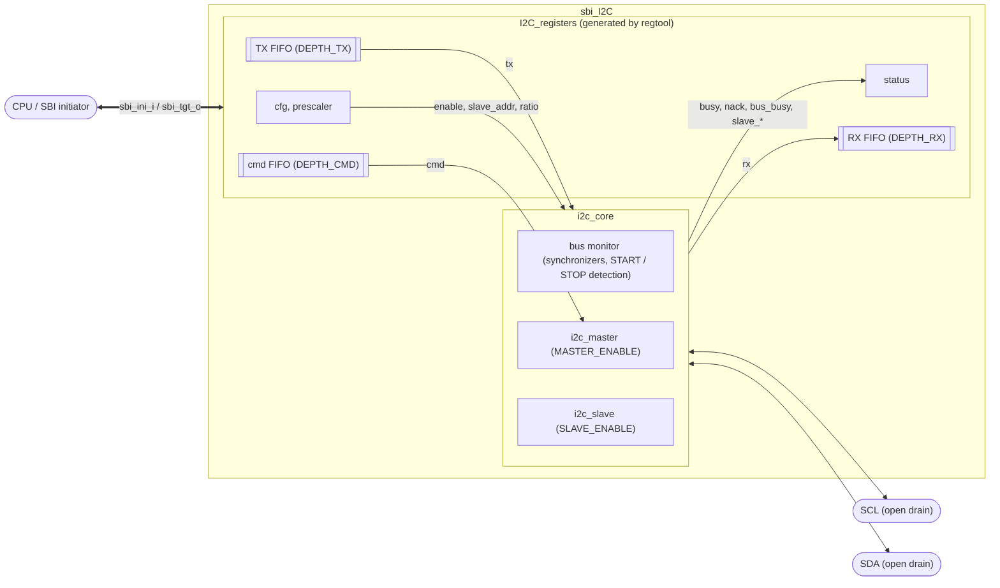
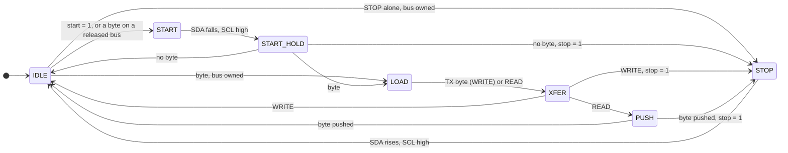

<!--
  README MODEL (common to every Asylum IP, keep the same headings)
  ----------------------------------------------------------------
  Regenerate from the sources, never from the previous README text alone:
    hdl/*.vhd (entities, generics, ports), hdl/csr/*.hjson (register map),
    <IP>.core (VLNV, targets, depends), mk/targets.txt, sim/, syn/, esw/.
  Sections, in this order:
    badges / title + one-line pitch / Overview / Features / Block Diagram /
    Getting Started / Hardware Interfaces / Configuration /
    Theory of Operation / Registers / Programmer's Guide /
    Design Verification / Dependencies and Related IPs / License
  Rules:
    - English, short and factual: every statement backed by the sources.
    - No VLNV line: the version badge shows it.
    - Badges: first line version, license; second line CI, lint, sim.
    - Block diagram and FSM in Mermaid (rendered by GitHub).
    - Registers: link to the generated hdl/csr/<X>_csr.md, never copy the tables.
    - Tables: Configuration = Name|Type|Default|Description,
      Hardware Interfaces = Name|Direction|Type|Description, grouped by interface.
    - A section with nothing to say is one line ("This IP has no
      software-visible registers."), never removed.
-->
[](https://github.com/deuskane/asylum-communication-i2c/tags)
[](LICENSE)

[](https://github.com/deuskane/asylum-communication-i2c/actions/workflows/ci.yml)
[](https://github.com/deuskane/asylum-communication-i2c/actions/workflows/ci.yml)
[](https://github.com/deuskane/asylum-communication-i2c/actions/workflows/ci.yml)

# I2C master / slave

**A small, readable I2C controller in VHDL: master and slave in one IP, clock stretching, command FIFO, verified with UVVM scenario by scenario.**

Part of the [Asylum project](https://github.com/deuskane/asylum-project), a collection of small FPGA IP cores written to be read and learned from.

## Table of Contents

1. [Overview](#overview)
2. [Features](#features)
3. [Block Diagram](#block-diagram)
4. [Getting Started](#getting-started)
5. [Hardware Interfaces](#hardware-interfaces)
6. [Configuration](#configuration)
7. [Theory of Operation](#theory-of-operation)
8. [Registers](#registers)
9. [Programmer's Guide](#programmers-guide)
10. [Design Verification](#design-verification)
11. [Dependencies and Related IPs](#dependencies-and-related-ips)
12. [License](#license)

## Overview

This IP connects a CPU to an I2C bus, as a master, as a slave, or both. Software drives it through four 8-bit registers on the SBI bus (the simple bus of Asylum):

- **master**: each step of a transfer (START, one byte, STOP) is a command written to a command FIFO; the bytes to write (address byte included) go through a TX FIFO, the bytes read come back through an RX FIFO;
- **slave**: it answers to a 7-bit address; the bytes written by the remote master arrive in the RX FIFO, the bytes it reads are taken from the TX FIFO, and SCL is stretched while software is late.

The protocol engine, `i2c_core`, has AXI-Stream-like valid/ready interfaces and can also be used on its own, without the registers.

## Features

- I2C master: START, repeated START, STOP, byte write with acknowledge check, byte read answered by ACK or NACK
- I2C slave: 7-bit address (0 disables the slave), master write, master read, repeated START
- Clock stretching: accepted by the master, generated by the slave when its TX FIFO is empty or its RX FIFO is full
- Programmable SCL frequency (100 kHz, 400 kHz, 1 MHz...), fixed or software-writable
- Bus monitor: SCL / SDA synchronizers, START / STOP detection, bus busy flag; the master waits for a free bus before a START
- Status register: master busy, NACK received, bus busy, slave addressed, slave direction, RX FIFO empty
- Configurable FIFO depths (0 = no storage)
- Master or slave removable at elaboration to save area
- Open-drain outputs for tri-state IO buffers
- Simulation only: dump of the CMD / TX / RX traffic to text files

## Block Diagram



A drawio version of this diagram is kept in [doc/I2C.drawio](doc/I2C.drawio).

## Getting Started

The cores of the Asylum IPs are published in the FuseSoC library [asylum-cores](https://github.com/deuskane/asylum-cores) (with the UVVM cores used by the testbenches):

```bash
pip install fusesoc
fusesoc library add https://github.com/deuskane/asylum-cores
fusesoc run --target sim_master_write asylum:communication:I2C      # needs GHDL
```

To use the IP in your design, add `asylum:communication:I2C` to the `depend` list of your core and instantiate `sbi_I2C` (library `asylum`):

```vhdl
library asylum;
use     asylum.sbi_pkg.all;
use     asylum.i2c_pkg.all;

  ins_i2c : sbi_I2C
    generic map
    ( NAME                  => "I2C0"
     ,PRESCALER_RATIO       => x"7C"    -- 100 kHz from 50 MHz
     ,DEPTH_CMD             => 4
     ,DEPTH_TX              => 4
     ,DEPTH_RX              => 4
    )
    port map
    ( clk_i     => clk
     ,arst_b_i  => arst_b
     ,sbi_ini_i => sbi_ini       -- 2 address bits, 8-bit data
     ,sbi_tgt_o => sbi_tgt
     ,scl_i     => i2c_scl_i
     ,scl_o     => i2c_scl_o
     ,scl_oe_o  => i2c_scl_oe
     ,sda_i     => i2c_sda_i
     ,sda_o     => i2c_sda_o
     ,sda_oe_o  => i2c_sda_oe
    );

  -- Open-drain pads, with a pull-up on the board
  scl_pad   <= i2c_scl_o when i2c_scl_oe = '1' else 'Z';
  i2c_scl_i <= scl_pad;
  sda_pad   <= i2c_sda_o when i2c_sda_oe = '1' else 'Z';
  i2c_sda_i <= sda_pad;
```

## Hardware Interfaces

Top-level entity: **`sbi_I2C`** ([hdl/sbi_I2C.vhd](hdl/sbi_I2C.vhd)), component in `asylum.i2c_pkg`.

### Clock and Reset

| Name | Direction | Type | Description |
|------|-----------|------|-------------|
| `clk_i` | in | std_logic | System clock, the only clock of the IP |
| `arst_b_i` | in | std_logic | Asynchronous reset, active low |

### Bus (SBI)

| Name | Direction | Type | Description |
|------|-----------|------|-------------|
| `sbi_ini_i` | in | sbi_ini_t | Request from the initiator (`cs`, `re`, `we`, `addr`, `wdata`); 2 address bits, 8-bit data |
| `sbi_tgt_o` | out | sbi_tgt_t | Response to the initiator (`ready`, `rdata`, `info`) |

### I2C

| Name | Direction | Type | Description |
|------|-----------|------|-------------|
| `scl_i` | in | std_logic | SCL level from the pad (synchronized inside) |
| `scl_o` | out | std_logic | Always `0` (open drain) |
| `scl_oe_o` | out | std_logic | `1` pulls SCL low |
| `sda_i` | in | std_logic | SDA level from the pad (synchronized inside) |
| `sda_o` | out | std_logic | Always `0` (open drain) |
| `sda_oe_o` | out | std_logic | `1` pulls SDA low |

SCL and SDA need a pull-up. There is no spike filter on `scl_i` / `sda_i`.

<details>
<summary><b>i2c_core</b>: protocol engine, for a standalone use without the registers</summary>

[hdl/i2c_core.vhd](hdl/i2c_core.vhd), component in `asylum.i2c_pkg`. Generics: `PRESCALER_WIDTH` (8), `MASTER_ENABLE`, `SLAVE_ENABLE`. A command is a beat of the command channel, a byte a beat of the TX or RX channel.

| Name | Direction | Type | Description |
|------|-----------|------|-------------|
| `clk_i` | in | std_logic | System clock |
| `arst_b_i` | in | std_logic | Asynchronous reset, active low (`cfg.enable` in `sbi_I2C`) |
| `tx_tvalid_i` / `tx_tready_o` / `tx_tdata_i` | in / out / in | std_logic / std_logic / std_logic_vector(7 downto 0) | Byte to send (master: byte of a WRITE command; slave: byte read by the remote master) |
| `rx_tvalid_o` / `rx_tready_i` / `rx_tdata_o` | out / in / out | std_logic / std_logic / std_logic_vector(7 downto 0) | Byte received (master: byte of a READ command; slave: byte written by the remote master) |
| `cmd_tvalid_i` / `cmd_tready_o` | in / out | std_logic | Command handshake (accepted in IDLE, when the master owns the bus or the bus is free) |
| `cmd_start_i` | in | std_logic | 1: START or repeated START before the byte |
| `cmd_stop_i` | in | std_logic | 1: STOP after the byte |
| `cmd_op_i` | in | std_logic_vector(1 downto 0) | `I2C_OP_NONE`, `I2C_OP_WRITE`, `I2C_OP_READ_ACK`, `I2C_OP_READ_NACK` |
| `cfg_prescaler_ratio_i` | in | std_logic_vector(PRESCALER_WIDTH-1 downto 0) | Quarter of the SCL period minus one, in clock cycles |
| `cfg_slave_addr_i` | in | std_logic_vector(6 downto 0) | Slave address, 0 disables the slave |
| `sts_busy_o` | out | std_logic | Master: command in progress or pending |
| `sts_nack_o` | out | std_logic | Master: NACK received on a written byte since the last START on a released bus |
| `sts_bus_busy_o` | out | std_logic | START detected and no STOP since |
| `sts_slave_addressed_o` | out | std_logic | Slave: address acknowledged, until the next STOP or START |
| `sts_slave_read_o` | out | std_logic | Slave: R/W bit of the last acknowledged address (1: the remote master reads) |
| `scl_i`, `scl_o`, `scl_oe_o`, `sda_i`, `sda_o`, `sda_oe_o` | | | Same as `sbi_I2C` |

</details>

## Configuration

Generics of `sbi_I2C`:

| Name | Type | Default | Description |
|------|------|---------|-------------|
| `NAME` | string | `""` | Instance name, visible in `sbi_tgt_o.info` |
| `USER_DEFINE_PRESCALER` | boolean | `true` | `true`: the `prescaler` register is software-writable; `false`: the ratio is fixed to `PRESCALER_RATIO` |
| `PRESCALER_RATIO` | std_logic_vector(7 downto 0) | `x"7C"` | Reset (or fixed) value of the prescaler ratio (`x"7C"`: 99.6 kHz with a 50 MHz clock) |
| `MASTER_ENABLE` | boolean | `true` | Implement the master and the `cmd` register |
| `SLAVE_ENABLE` | boolean | `true` | Implement the slave |
| `DEPTH_CMD` | natural | `0` | Depth of the command FIFO (0 = no FIFO) |
| `DEPTH_TX` | natural | `0` | Depth of the TX FIFO (0 = no FIFO) |
| `DEPTH_RX` | natural | `0` | Depth of the RX FIFO (0 = no FIFO) |
| `FILENAME_CMD` / `FILENAME_TX` / `FILENAME_RX` | string | `"dump_i2c_cmd.txt"` / `"dump_i2c_tx.txt"` / `"dump_i2c_rx.txt"` | Simulation only: dump files of the accepted commands, sent and received bytes |

The FIFO depths set most of the area of the IP.

## Theory of Operation

### Hierarchy

| File | Unit | Role |
|------|------|------|
| [hdl/sbi_I2C.vhd](hdl/sbi_I2C.vhd) | `sbi_I2C` | Top level: registers, `i2c_core`, simulation dumps |
| [hdl/i2c_core.vhd](hdl/i2c_core.vhd) | `i2c_core` | Bus monitor, `i2c_master`, `i2c_slave`, shared TX / RX channels, open-drain outputs |
| [hdl/i2c_master.vhd](hdl/i2c_master.vhd) | `i2c_master` | Master engine driven by the commands: prescaler, FSM, shift register |
| [hdl/i2c_slave.vhd](hdl/i2c_slave.vhd) | `i2c_slave` | Slave engine: address match, receive, transmit, clock stretching |
| [hdl/i2c_pkg.vhd](hdl/i2c_pkg.vhd) | `i2c_pkg` | Components, byte operations (`I2C_OP_*`) |
| `hdl/csr/I2C_csr.vhd` | `I2C_registers` | Register bank and FIFOs, generated by regtool from [hdl/csr/I2C.hjson](hdl/csr/I2C.hjson) |

### Data path

`data` is a bidirectional FIFO register: a write pushes a byte in the TX FIFO, a read pops a byte from the RX FIFO. `cmd` is a write-only FIFO register at the address of `status` (writes go to `cmd`, reads return `status`). Both FIFO registers are *blocking*: an access waits (holds the bus) until the FIFO can accept or provide the data. The TX and RX channels are shared by the master and the slave (the master has the priority); the output enables of both are ORed on the pads.

`cfg.enable` is the reset of `i2c_core`: with `enable = 0`, SCL and SDA are released.

### Bus monitor

`scl_i` and `sda_i` go through two-flop synchronizers (`sync2dffrn` of asylum techmap). The monitor detects the SCL edges, the START (SDA falls while SCL is high) and the STOP (SDA rises while SCL is high), and keeps a bus busy flag between them.

### Master commands

A command is executed in this order: START (or repeated START) if `start = 1`, one byte if `op` is not `NONE`, STOP if `stop = 1`.

- `WRITE`: a byte is popped from the TX FIFO and sent, the acknowledge of the slave is sampled (NACK sets `status.nack`).
- `READ_ACK` / `READ_NACK`: a byte is received, pushed in the RX FIFO and answered by ACK (more bytes to come) or NACK (last byte).
- The address byte is a written byte: `(address << 1) | R/W`.
- If the master does not own the bus, a command with a byte always begins with a START, and a STOP alone is ignored.
- Before a START on a released bus, the master waits for `bus_busy = 0`. There is no arbitration: one master per bus.
- A NACK does not stop the next commands: software checks `status.nack` at the end. It is cleared by the next START on a released bus.
- While the master waits for a command, a TX byte or room in the RX FIFO, it holds SCL low.



`XFER` sends or receives the 8 data bits MSB first, then the acknowledge bit.

### Slave

The slave FSM follows the bus: **ADDR** receives the address byte after a START, **ADDR_ACK** acknowledges it when it matches `cfg.slave_addr`, then **RX / RX_PUSH / RX_ACK** for a master write or **TX_LOAD / TX / TX_ACK** for a master read; **SETUP** holds the data setup time before releasing SCL after a stretching. A START goes to ADDR and a STOP to IDLE, from any state.

The slave drives SDA after the falling edges of SCL and samples it on the rising edges. It stretches SCL (holds it low) while its TX FIFO is empty (master read) or its RX FIFO is full (master write); after a stretching, it releases SCL `ratio + 1` clock cycles after driving SDA. General call and 10-bit addresses are not supported, and the master must not address the slave of the same core.

### SCL timing

A SCL period of the master is 4 quarters of `ratio + 1` clock cycles. SDA changes in the middle of the low phase and is sampled in the middle of the high phase. While SCL is released but still seen low (stretching by a slave, synchronizer delay), the quarter counter is reloaded: the high phase lasts 2 quarters from the time SCL is seen high.

```
  quarter : |   0   |   1   |   2   |   3   |   0   |   1   |
                             _______________
  SCL     : ________________/               \_______________
            ________ _______________________________ _______
  SDA     : ________X_______________________________X_______
                    ^ SDA driven    ^ SDA sampled
```

SCL period = `4 x (ratio + 1) + 2` clock cycles (the 2 cycles of the `scl_i` synchronizer extend each high phase, plus the rise time of SCL on a real bus), so `ratio = (f_clk / f_scl - 2) / 4 - 1`. With a 50 MHz clock: `ratio = 124` (`x"7C"`) gives 99.6 kHz, `ratio = 30` gives 396.8 kHz, `ratio = 11` gives 1 MHz.

## Registers

Four 8-bit registers (2 address bits): `data` (0x0), `cmd` (0x1, write) / `status` (0x1, read), `cfg` (0x2), `prescaler` (0x3). `cmd` exists only when `MASTER_ENABLE = true`, `prescaler` only when `USER_DEFINE_PRESCALER = true`.

- Register documentation: **[hdl/csr/I2C_csr.md](hdl/csr/I2C_csr.md)**
- C header: [hdl/csr/I2C_csr.h](hdl/csr/I2C_csr.h)
- Source: [hdl/csr/I2C.hjson](hdl/csr/I2C.hjson) (regtool)

## Programmer's Guide

### Initialization

1. Write `prescaler.ratio` (only when `USER_DEFINE_PRESCALER = true`).
2. Write `cfg = (slave_addr << 1) | 1`: enable, and slave address (0: no slave).

Change `cfg.slave_addr` and `prescaler` with `cfg.enable = 0` or while the bus is idle.

### Master transfers

For each byte, write the command to `cmd`, then its byte to `data` (WRITE) or read the byte from `data` (READ). This order works with every FIFO depth, including 0: with `DEPTH_TX = 0` a write to `data` completes only when the master takes the byte, so the byte must not be written before its command. With FIFOs, several commands and bytes can be written in advance.

At the end of the transfer, wait for `status.busy = 0`, then check `status.nack = 0`.

Command values (`start` bit 0, `stop` bit 1, `op` bits 3:2):

| Value | Command |
|-------|---------|
| `0x05` | START + WRITE (address byte) |
| `0x04` | WRITE |
| `0x06` | WRITE + STOP |
| `0x08` | READ_ACK |
| `0x0E` | READ_NACK + STOP |
| `0x02` | STOP alone |

### Example: read registers of an I2C device

`reg_wr` / `reg_rd` are the 8-bit register accesses of your CPU.

```c
#include "I2C_csr.h"

static void i2c_write_byte(uint8_t cmd, uint8_t byte)
{
  reg_wr(I2C_CMD,  cmd);
  reg_wr(I2C_DATA, byte);
}

// Read n bytes from register reg of the device at 7-bit address dev.
// Returns 1 if a byte was not acknowledged.
int i2c_read_reg(uint8_t dev, uint8_t reg, uint8_t *buf, int n)
{
  i2c_write_byte(I2C_CMD_START_ENABLE_RAW | I2C_CMD_OP_WRITE_RAW, dev << 1);       // START, address + W
  i2c_write_byte(I2C_CMD_OP_WRITE_RAW, reg);                                       // register address
  i2c_write_byte(I2C_CMD_START_ENABLE_RAW | I2C_CMD_OP_WRITE_RAW, (dev << 1) | 1); // repeated START, address + R

  for (int i = 0; i < n; i++) {
    reg_wr(I2C_CMD, (i < n-1) ? I2C_CMD_OP_READ_ACK_RAW
                              : I2C_CMD_OP_READ_NACK_RAW | I2C_CMD_STOP_ENABLE_RAW);
    while (reg_rd(I2C_STATUS) & (1 << I2C_STATUS_RX_EMPTY))
      ;                                       // wait without blocking the bus
    buf[i] = reg_rd(I2C_DATA);
  }

  while (reg_rd(I2C_STATUS) & (1 << I2C_STATUS_BUSY))
    ;
  return (reg_rd(I2C_STATUS) >> I2C_STATUS_NACK) & 1;
}
```

On a NACK the remaining commands are still executed: check the return value before using `buf`.

### Slave

1. Remote master write: the bytes arrive in the RX FIFO (`status.slave_addressed = 1`, `status.slave_read = 0`); read `data` while `status.rx_empty = 0`. When the RX FIFO is full, SCL is stretched until a byte is read.
2. Remote master read: write the bytes to `data`, before or during the transfer. When the TX FIFO is empty, SCL is stretched until a byte is written (`status.slave_addressed = 1`, `status.slave_read = 1`). The transfer ends on the NACK of the remote master.

## Design Verification

### Testbenches

| File | DUT | Description |
|------|-----|-------------|
| [sim/basic/tb_I2C.vhd](sim/basic/tb_I2C.vhd) | `sbi_I2C` | Self-checking UVVM testbench, one scenario per simulation selected by the generic `TEST`. The registers are accessed with the UVVM SBI BFM, the I2C bus (open drain, pull-up) is driven by the UVVM I2C BFM as master or slave. A bench process stretches SCL on request and a monitor measures the SCL period and high phase |
| [sim/multi/tb_I2C_multi.vhd](sim/multi/tb_I2C_multi.vhd) | `NB_SLAVE+1` x `sbi_I2C` | Self-checking UVVM testbench: one `sbi_I2C` master and `NB_SLAVE` `sbi_I2C` slaves on the same bus. Writes to and reads from each slave, write + repeated START + read to two different slaves, slave clock stretching on an empty TX FIFO, absent address (NACK) |

The slave clock stretching on a full RX FIFO is not checked: the UVVM I2C BFM master samples the acknowledge without waiting for SCL high. All the simulations use FIFO depths 4 / 8 / 8.

### Targets

One target per scenario, each one starts from reset and runs alone (in parallel in the CI):

| Target | Scenario |
|--------|----------|
| `sim_reset_values` | Reset values of `cfg`, `prescaler`, `status`; pads released |
| `sim_master_write` | DUT master writes 3 bytes to the BFM slave; SCL period and high phase (ratio 4) |
| `sim_master_read` | DUT master reads 3 bytes from the BFM slave |
| `sim_master_write_read` | DUT master write + repeated START + read (register read) |
| `sim_master_nack` | DUT master writes to an absent slave: `status.nack = 1`, cleared by the next transfer |
| `sim_master_stretch` | DUT master write with SCL stretched 3 µs by the bench |
| `sim_master_prescaler` | SCL period and high phase with ratio 9 |
| `sim_slave_write` | BFM master writes 4 bytes to the DUT slave |
| `sim_slave_read` | BFM master reads 3 bytes from the DUT slave |
| `sim_slave_stretch` | BFM master reads from the DUT slave with an empty TX FIFO: SCL held low until the bytes are written |
| `sim_slave_write_read` | BFM master write + repeated START + read from the DUT slave |
| `sim_slave_wrong_address` | NACK on another address |
| `sim_slave_disabled` | NACK when `cfg.slave_addr = 0` |
| `sim_disabled` | NACK and pads released when `cfg.enable = 0` |
| `sim_multi_slave` | One master and 3 slaves `sbi_I2C` on the same bus |
| `lint_ghdl` | GHDL `-Wall` analysis and elaboration of [syn/sbi_I2C_wrapper.vhd](syn/sbi_I2C_wrapper.vhd) |
| `lint_ghdl_synth_<config>` | `ghdl --synth` check for 5 generic configurations: `default`, `sim`, `master_only`, `slave_only`, `fixed_prescaler` |

Every `sim_*` and `lint_*` target is a job of the [GitHub CI](https://github.com/deuskane/asylum-communication-i2c/actions/workflows/ci.yml), run in the [asylum-env](https://github.com/deuskane/asylum-ci) image (GHDL, FuseSoC, UVVM). The `sim` and `lint` badges count the passed and failed targets of the last run on `main`.

### How to Run

From a clone of [asylum-project](https://github.com/deuskane/asylum-project) (GHDL and FuseSoC installed, or in the asylum-env image):

```bash
make help                        # variables, rules and targets
make sim_master_write            # one target, log in log/
make nonreg_sim                  # every sim_* target
make nonreg_lint                 # every lint_* target
make TARGETS_FILTER=^sim_slave nonreg_sim
```

To add a scenario: a `test_<name>` procedure in the sequencer of `tb_I2C`, its case in the dispatch on `TEST`, a `sim_<name>` target with `TEST=<name>` in [I2C.core](I2C.core), then `make ci_generate`.

Outside the CI, GHDL writes a waveform `dut.fst`, and `sbi_I2C` writes the dumps `dump_i2c_cmd.txt`, `dump_i2c_tx.txt`, `dump_i2c_rx.txt`.

## Dependencies and Related IPs

| Core | Repository | Purpose |
|------|------------|---------|
| `asylum:utils:generators` | [asylum-utils-generators](https://github.com/deuskane/asylum-utils-generators) | regtool (register generator) and the CSR building blocks (`csr_reg`, `csr_ext`, `csr_fifo`) |
| `asylum:utils:pkg` | [asylum-utils-pkg](https://github.com/deuskane/asylum-utils-pkg) | Common packages (`sbi_pkg`, ...) |
| `asylum:target:techmap` | [asylum-target-techmap](https://github.com/deuskane/asylum-target-techmap) | `sync2dffrn` synchronizers of SCL and SDA |
| `bitvis:verification:uvvm` | [UVVM](https://github.com/UVVM/UVVM) | Verification library, SBI and I2C BFMs |

Other communication IPs of Asylum: [SPI](https://github.com/deuskane/asylum-communication-spi), [UART](https://github.com/deuskane/asylum-communication-uart). All the IPs: [asylum-project](https://github.com/deuskane/asylum-project).

## License

Apache License 2.0, see [LICENSE](LICENSE).
